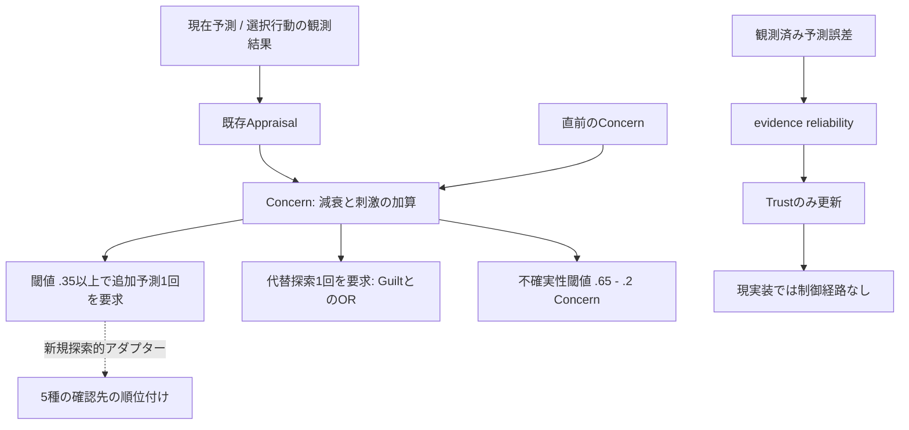

# Concernの既存因果経路と今回の切り分け

2026-10-09。functional moral affectの機能を検証する。人間の主観的感情を主張しない。

既定の更新は `clip(.8*C + .4*probability_weighted_harm + .45*uncertainty + .2*norm_violation + .15*irreversible_risk)`。減衰は時間でなく更新イベントごと。`evidence_reliability=1-error`はTrustだけに入り、誤り率をConcernへ置き換えない。

既存コード: `affect/appraisal.py`、`affect/agent.py`の`control_plan`。旧v0.2.xでは現在状況を同じにして誤予測だけを増やしてもConcernと判断は変わらず、被害観測を増やすと変わった。新テストでもこの区別を検査する。

Concern OFFでは`concern_enabled=False`だけを使う。`enabled=False`や`behavior_enabled=False`で他Affectを消さない。状態のみはConcernを通常更新し、制御計画を作るときだけConcernを無効化する。同じ入力履歴ならOFFと状態のみの他Affect・確認選択・判断が一致する。

主実験では代替候補は共通カタログにあり、予測器・道徳制約・他Affectの実装を共通にする。Empathy/Guiltは同じMappingと既存の慎重さ・可逆性選好を全条件で使う。Concernが要求する追加予測/代替探索は、実験Iでは共通スケジュールにより固定/遮断する。要求はログに残す。実験IIでは既存の要求強度を確認先順位への追加項へ写像する。この順位付けは**新規探索的規則**で、既存Concernの能力とは呼ばない。

最終判断へのConcern経路は既存の不確実性閾値低下のみ。選択介入と独立にON/OFFできる。Concernによる代替探索要求から新しい候補を生成する経路は今回固定するため、本実験だけで元のAffectAgent全機能を評価したとは言わない。

同一判断時点・同一状態で最終判断スイッチだけを変える反事実を併記する。Episode全体の最終介入ON/OFFは、選ばれた行動に応じて後の観測履歴が分かれるため、同一入力下の直接効果とは別の総効果である。
